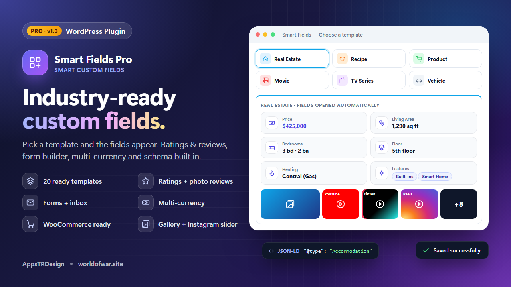

<p align="center">
  
</p>

<h1 align="center">Smart Fields Pro</h1>

<p align="center">
  <b>Industry-ready custom field templates for WordPress</b><br>
  Pick a template and the right fields appear. Schema.org JSON-LD, ratings &amp; reviews, forms, multi-currency and WooCommerce built in.
</p>

<p align="center">
  
  
  
  
  
  
</p>

<p align="center">
  <a href="https://wplugins.shop/eklenti/smart-fields-pro.zip"><b>⬇ Download</b></a> ·
  <a href="#features">Features</a> ·
  <a href="#shortcodes">Shortcodes</a> ·
  <a href="#php-api">PHP API</a> ·
  <a href="README.tr.md">🇹🇷 Türkçe</a>
</p>

---

## Why Smart Fields Pro?

Classic custom field builders give you an empty canvas. Smart Fields Pro gives you **finished field sets for real industries**. Open a post, pick **Real Estate** and you get price, area, rooms, floor, heating and location. Pick **Recipe** and you get ingredients, illustrated steps, prep time, servings and scores. Every field is already mapped to **schema.org JSON-LD**, included in search and styled for mobile.

Still need something custom? Add your own fields with the drag-and-drop builder, or start from a blank group.

## Features

### 🧩 Templates & fields
- **20 ready-made templates:** Real Estate, Recipe, Product, Movie, TV Series, Event, Job Posting, Vehicle, Book, Hotel, Restaurant, Course, Software, WordPress Plugin / Theme, Program Download, Video Game, Music Album, Local Business, Product Review and Doctor / Clinic, plus a Blank group.
- **32 field types:** text, rich editor, number, range, email, URL, phone, select, multi select, radio, checkboxes, yes/no, date, time, duration, price (multi-currency), star rating, **multi rating**, color, address + map, list, key–value table, **grouped list**, **steps with image/video**, image, gallery, file, **download with counter**, video and section heading.
- **Rich text Short Description** in every template. When a post has no content it becomes the excerpt, the search text, the WooCommerce short description and the JSON-LD description.
- **Drag-and-drop field builder** with icons, widths, units, defaults, options, required fields and per-field search/filter/card switches.
- Works in **Gutenberg and the Classic Editor**. Required fields lock publishing.

### ⭐ Ratings & reviews
- One-click **visitor star rating** with a summary card: distribution bars on the left, a big score on the right.
- **Advanced review section** that replaces the theme comments in both block and classic themes. It includes its own form designer, **photo reviews**, likes, highlighted owner replies, AJAX sorting and paging.
- Switches for **members-only reviews and likes**, plus photo reviews for members only or everyone.
- **Site-wide Reviews page**, created automatically, with template, star and photo filters and a top-rated list.
- Everything is exported to JSON-LD: `aggregateRating`, `Review` (up to 200 reviews) and `reviewAspect` for multi-criteria scores.

### 📨 Forms & inbox
- Form builder with **contact, quote, appointment and survey** presets.
- Email notifications and an optional auto-reply, sent with **WordPress mail or SMTP**. A test email button checks the setup.
- An **admin inbox** that shows which form each message came from. Read, reply, delete and use bulk actions with AJAX paging and an unread badge.
- Spam protection with a honeypot, a signed time token and a rate limit, with no captcha needed.

### 🖼 Media
- An optional **media gallery** in every template: uploads plus YouTube (including Shorts), TikTok, Instagram posts and Reels, Vimeo, Facebook, Dailymotion, Twitch, Spotify and SoundCloud.
- An **Instagram-style lightbox** with swipe, swipe-down to close, pinch and double-tap zoom, and videos that play inside it.
- **Automatic featured image:** the first gallery image becomes the featured image when none is set.

### 🔎 Search, money & SEO
- Field values (and WooCommerce SKUs) are added to the native WordPress search without replacing it.
- **AJAX search section** with filters, chips, grid or list views, a mobile filter sheet, and page numbers or load more. An optional **search page** replaces the theme's `?s=` results.
- **Multi-currency prices:** each post sets its own currency, exchange rates are entered manually or updated automatically from CBRT, and visitors get a currency switcher. Filters and sorting compare prices in the base currency.
- **Automatic schema.org JSON-LD:** Product, Accommodation, Recipe (HowToStep with images), Movie, TVSeries, Event, JobPosting, Car, Book, Hotel, Restaurant, Course, SoftwareApplication, VideoGame, MusicAlbum, LocalBusiness, Review and Physician.

### 🛒 WooCommerce & admin
- Fields appear in a product tab or summary, and the schema is merged into WooCommerce's Product markup without duplicates. **HPOS compatible.**
- A modern single-page admin where every action runs over AJAX, with custom modals and toasts. It works fully on mobile.
- Front-end styles are isolated, so themes cannot break them and they never leak into the theme.
- Translation ready: English source `.pot` and a full Turkish translation.

<p align="center"></p>

## Installation

1. [Download the zip](https://wplugins.shop/eklenti/smart-fields-pro.zip).
2. In WordPress go to **Plugins → Add New → Upload Plugin**, upload the zip and activate it.
3. Open **Smart Fields → Template Gallery**, pick a template and choose the post types it applies to.
4. Edit a post, select the template in the **Smart Fields** box, fill in the fields and publish.

Optional: enable **Reviews & Ratings**, **Mail/SMTP**, **Currencies** and the **Search page** under **Smart Fields → Settings**.

## Shortcodes

| Shortcode | Description |
|---|---|
| `[sfp_fields]` | All fields of the current post (`fields`, `exclude`, `layout`, `title`, `id`) |
| `[sfp_field key="price"]` | A single formatted value |
| `[sfp_gallery]` | Media gallery of the current post |
| `[sfp_search group="GROUP_ID"]` | Filterable AJAX search section (`per_page`, `columns`, `pagination`, `view`) |
| `[sfp_search]` | Search across all content with template tabs |
| `[sfp_form id="FORM_ID"]` | A form built under **Smart Fields → Forms** |
| `[sfp_reviews]` | Review section of the current post |
| `[sfp_rating]` | Rating summary card with quick voting |
| `[sfp_reviews_page]` | Site-wide latest reviews with filters |
| `[sfp_currency]` | Visitor currency switcher |

Gutenberg blocks: **Smart Fields** (all fields, one field or the gallery) and **Smart Fields Search**.

## PHP API

```php
// Raw value
$price = sfp_get_field( 'price' );

// Formatted HTML
sfp_the_field( 'price' );

// Plain text
echo esc_html( sfp_get_field( 'rooms', null, 'plain' ) );

// Whole box
sfp_fields_box( get_the_ID(), array( 'layout' => 'table' ) );
```

**Filters:** `sfp_templates`, `sfp_field_types`, `sfp_schema_data`, `sfp_render_box`, `sfp_format_value`, `sfp_search_query_args`, `sfp_schema_reviews_max`, `sfp_reviews_active`, `sfp_reviews_on_products`.

## Requirements

- WordPress 6.0 or later
- PHP 7.4 or later
- Optional: WooCommerce (HPOS supported)

## Changelog

### 1.3.1

* New: visitor ratings with a summary card; all ratings and reviews are added to JSON-LD.
* New: advanced review section with photo reviews, likes, owner replies, members-only switches, and AJAX sorting and paging.
* New: site-wide Reviews page with filters and a top-rated list.
* New: form builder with presets, notifications, auto-reply, WordPress mail or SMTP, and an admin inbox.
* New: Steps field with an image or video per step, and a Multi Rating field.
* New: multi-currency prices with exchange rates and a visitor currency switcher.
* New: rich text Short Description in every template and an automatic featured image from the gallery.
* Improved: every new screen is fully responsive.
* Adds ratings and reviews, a form builder with inbox, multi-currency prices and a Short Description field. Reviews, quick ratings and the currency switcher stay off until you enable them.

### 1.3.0
- Visitor ratings, an advanced review section (photo reviews, likes, owner replies) and a site-wide Reviews page. All of it is exported to JSON-LD.
- Form builder with WordPress mail or SMTP and an admin inbox.
- New Steps (image/video) and Multi Rating fields.
- Multi-currency prices with exchange rates and a currency switcher.
- Rich text Short Description and an automatic featured image from the gallery.

### 1.2.0
- Grouped List field, an optional advanced search page and search across all content.

### 1.1.0
- Media gallery, Instagram-style lightbox, Download field, plugin and program templates, and a redesigned AJAX search.

## License

GPLv2 or later. Developed by **AppsTRDesign** — [wplugins.shop](https://wplugins.shop)
