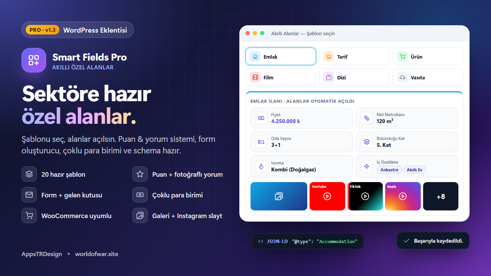

<p align="center">
  
</p>

<h1 align="center">Smart Fields Pro</h1>

<p align="center">
  <b>WordPress için sektöre hazır özel alan şablonları</b><br>
  Şablonu seç, alanlar açılsın. Schema.org JSON-LD, puan ve yorum sistemi, formlar, çoklu para birimi ve WooCommerce desteği hazır.
</p>

<p align="center">
  
  
  
  
  
</p>

<p align="center">
  <a href="https://wplugins.shop/eklenti/smart-fields-pro.zip"><b>⬇ İndir</b></a> ·
  <a href="#özellikler">Özellikler</a> ·
  <a href="#kısa-kodlar">Kısa Kodlar</a> ·
  <a href="#php-api">PHP API</a> ·
  <a href="README.md">🇬🇧 English</a>
</p>

---

## Neden Smart Fields Pro?

Klasik özel alan eklentileri size boş bir sayfa verir. Smart Fields Pro ise **gerçek sektörler için hazırlanmış alan setleri** sunar. Yazıyı açıp **Emlak** şablonunu seçtiğinizde fiyat, metrekare, oda sayısı, kat, ısınma ve konum alanları gelir. **Tarif** seçtiğinizde malzemeler, resimli adımlar, hazırlık süresi, porsiyon ve puanlar hazırdır. Her alan **schema.org JSON-LD** verisine bağlıdır, aramaya dahildir ve mobil uyumlu tasarlanmıştır.

Ekstra bir şeye mi ihtiyacınız var? Sürükle-bırak oluşturucuyla kendi alanlarınızı ekleyin ya da boş bir grupla başlayın.

## Özellikler

### 🧩 Şablonlar ve alanlar
- **20 hazır şablon:** Emlak, Yemek Tarifi, Ürün, Film, Dizi, Etkinlik, İş İlanı, Vasıta, Kitap, Otel, Restoran, Kurs, Yazılım, WordPress Eklenti / Tema, Program İndirme, Video Oyunu, Müzik Albümü, Yerel İşletme, Ürün İncelemesi ve Doktor / Klinik. Ayrıca bir Boş Grup.
- **32 alan türü:** metin, zengin editör, sayı, kaydırıcı, e-posta, bağlantı, telefon, açılır liste, çoklu seçim, radyo, onay kutuları, evet/hayır, tarih, saat, süre, fiyat (çoklu para birimi), yıldızlı puan, **çoklu puan**, renk, adres + harita, liste, özellik–değer tablosu, **gruplu liste**, **resimli/videolu adımlar**, görsel, galeri, dosya, **sayaçlı indirme**, video ve bölüm başlığı.
- Tüm şablonlarda **zengin metinli Kısa Açıklama**. İçerik yazmasanız bile özet, arama metni, WooCommerce kısa açıklaması ve JSON-LD açıklaması buradan alınır.
- İkon, genişlik, birim, varsayılan değer, seçenekler ve zorunlu alan ayarlarıyla **sürükle-bırak alan oluşturucu**. Her alan için arama, filtre ve kart anahtarları vardır.
- **Gutenberg ve Klasik Editör** ile çalışır. Zorunlu alanlar doldurulmadan yayınlanamaz.

### ⭐ Puan ve yorumlar
- Tek tıkla **ziyaretçi yıldız puanı** ve özet kartı: solda dağılım çubukları, sağda büyük ortalama puan.
- Blok ve klasik temalarda temanın yorumlarının yerini alan **gelişmiş yorum bölümü**. Kendi form tasarımcısı, **fotoğraflı değerlendirme**, beğeni, öne çıkan site sahibi yanıtı, AJAX sıralama ve sayfalama içerir.
- **Yalnızca üyeler yorum yazsın / beğensin** anahtarları. Fotoğraflı değerlendirme yalnızca üyelere veya herkese açılabilir.
- Otomatik oluşan **site geneli Yorumlar sayfası**. Şablon, yıldız ve fotoğraf filtreleri ile en yüksek puanlılar listesi vardır.
- Her şey JSON-LD'ye aktarılır: `aggregateRating`, `Review` (200 yoruma kadar) ve kriter puanları için `reviewAspect`.

### 📨 Formlar ve gelen kutusu
- **İletişim, teklif, randevu ve anket** hazır şablonlarıyla form oluşturucu.
- E-posta bildirimi ve isteğe bağlı otomatik yanıt, **WordPress maili veya SMTP** ile gönderilir. Kurulumu kontrol etmek için test maili butonu vardır.
- Mesajın hangi formdan geldiğini gösteren **admin gelen kutusu**. Okuma, yanıtlama, silme ve toplu işlemler; AJAX sayfalama ve okunmamış rozeti.
- Captcha gerektirmeyen spam koruması: bal küpü, imzalı zaman damgası ve hız sınırı.

### 🖼 Medya
- Tüm şablonlarda opsiyonel **medya galerisi**: yükleme + YouTube (Shorts dahil), TikTok, Instagram gönderi ve Reels, Vimeo, Facebook, Dailymotion, Twitch, Spotify ve SoundCloud.
- **Instagram tarzı slayt:** kaydırma, aşağı çekerek kapatma, iki parmak ve çift dokunuşla yakınlaştırma. Videolar slaytın içinde oynar.
- **Otomatik öne çıkan görsel:** öne çıkan görsel yoksa galerinin ilk resmi otomatik atanır.

### 🔎 Arama, para ve SEO
- Alan değerleri (ve WooCommerce SKU'ları) WordPress aramasına, aramanın yerini almadan eklenir.
- Filtreli, etiketli, ızgara veya liste görünümlü **AJAX arama bölümü**. Mobilde alttan açılan filtre paneli, sayfa numaraları veya "daha fazla yükle". İsteğe bağlı **arama sayfası** temanın `?s=` sonuçlarının yerini alır.
- **Çoklu para birimli fiyatlar:** her içerik kendi para birimini seçer; kurlar elle girilir veya TCMB'den otomatik güncellenir; ziyaretçiler için para birimi seçici vardır. Filtreler ve sıralama fiyatları ana para biriminde karşılaştırır.
- **Otomatik schema.org JSON-LD:** Product, Accommodation, Recipe (resimli HowToStep), Movie, TVSeries, Event, JobPosting, Car, Book, Hotel, Restaurant, Course, SoftwareApplication, VideoGame, MusicAlbum, LocalBusiness, Review ve Physician.

### 🛒 WooCommerce ve yönetim paneli
- Alanlar ürün sekmesinde veya özette görünür. Schema, tekrar oluşmadan WooCommerce Product verisiyle birleşir. **HPOS uyumlu.**
- Her işlemin AJAX ile yapıldığı, özel modal ve bildirimli modern tek sayfa yönetim paneli. Mobilde de eksiksiz çalışır.
- Ön yüz stilleri izole edilmiştir: tema bozamaz, stiller de temaya taşmaz.
- Çoklu dil desteği: İngilizce kaynak `.pot` ve eksiksiz Türkçe çeviri.

<p align="center"></p>

## Kurulum

1. [Zip dosyasını indirin](https://wplugins.shop/eklenti/smart-fields-pro.zip).
2. WordPress'te **Eklentiler → Yeni Ekle → Eklenti Yükle** yolunu izleyin, zip'i yükleyip etkinleştirin.
3. **Smart Fields → Şablon Galerisi**'ni açın, bir şablon seçin ve hangi içerik türlerinde kullanılacağını belirleyin.
4. Bir yazıyı düzenleyin, **Smart Fields** kutusundan şablonu seçin, alanları doldurup yayınlayın.

İsteğe bağlı: **Smart Fields → Ayarlar** altından **Yorumlar ve Puanlar**, **Mail/SMTP**, **Para Birimleri** ve **Arama sayfası**'nı açın.

## Kısa Kodlar

| Kısa kod | Açıklama |
|---|---|
| `[sfp_fields]` | İçeriğin tüm alanları (`fields`, `exclude`, `layout`, `title`, `id`) |
| `[sfp_field key="price"]` | Tek bir alanın biçimlendirilmiş değeri |
| `[sfp_gallery]` | İçeriğin medya galerisi |
| `[sfp_search group="GRUP_ID"]` | Filtrelenebilir AJAX arama bölümü (`per_page`, `columns`, `pagination`, `view`) |
| `[sfp_search]` | Tüm içerikte şablon sekmeleriyle arama |
| `[sfp_form id="FORM_ID"]` | **Smart Fields → Formlar**'da oluşturulan form |
| `[sfp_reviews]` | İçeriğin yorum bölümü |
| `[sfp_rating]` | Hızlı oylamalı puan özet kartı |
| `[sfp_reviews_page]` | Filtreli, site geneli son yorumlar |
| `[sfp_currency]` | Ziyaretçi para birimi seçici |

Gutenberg blokları: **Smart Fields** (tüm alanlar, tek alan veya galeri) ve **Smart Fields Search**.

## PHP API

```php
// Ham değer
$price = sfp_get_field( 'price' );

// Biçimlendirilmiş HTML
sfp_the_field( 'price' );

// Düz metin
echo esc_html( sfp_get_field( 'rooms', null, 'plain' ) );

// Tüm kutu
sfp_fields_box( get_the_ID(), array( 'layout' => 'table' ) );
```

**Filtreler:** `sfp_templates`, `sfp_field_types`, `sfp_schema_data`, `sfp_render_box`, `sfp_format_value`, `sfp_search_query_args`, `sfp_schema_reviews_max`, `sfp_reviews_active`, `sfp_reviews_on_products`.

## Gereksinimler

- WordPress 6.0 veya üstü
- PHP 7.4 veya üstü
- İsteğe bağlı: WooCommerce (HPOS desteklenir)

## Değişiklik Günlüğü

### 1.3.0
- Ziyaretçi puanları, gelişmiş yorum bölümü (fotoğraflı yorum, beğeni, site sahibi yanıtı) ve site geneli Yorumlar sayfası. Hepsi JSON-LD'ye aktarılır.
- WordPress maili veya SMTP ile çalışan form oluşturucu ve admin gelen kutusu.
- Yeni Adımlar (resim/video) ve Çoklu Puan alanları.
- Döviz kurları ve para birimi seçicili çoklu para birimi desteği.
- Zengin metinli Kısa Açıklama ve galeriden otomatik öne çıkan görsel.

### 1.2.0
- Gruplu Liste alanı, isteğe bağlı gelişmiş arama sayfası ve tüm içerikte arama.

### 1.1.0
- Medya galerisi, Instagram tarzı slayt, İndirme alanı, eklenti ve program şablonları, yeniden tasarlanan AJAX arama.

## Lisans

GPLv2 veya üstü. Geliştirici: **AppsTRDesign** — [worldofwar.site](https://wplugins.shop)
